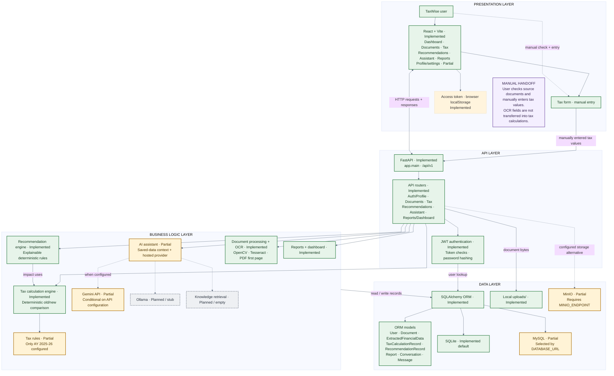

# TaxWise AI — verified architecture

This document describes the implementation found in the repository, rather than treating every item in the project README as wired functionality. The diagrams use these status labels:

- **Implemented** — a source path exists and is exercised by application code (and, where present, tests).
- **Partial** — a working path exists but needs configuration, covers only part of the stated feature, or lacks an important user-facing step.
- **Planned / stub** — a component is described or provisioned, but is not active in the application path.

## Architecture at a glance



## Components and evidence

| Component | Status | Verified responsibility and boundary |
|---|---|---|
| Frontend | Implemented, with partial profile/preferences | `frontend/src/App.tsx` routes to login and workspace pages. The pages call functions in `frontend/src/lib/api.ts`; login/register saves the bearer token in browser local storage, workspace routes require a token, and 401 responses clear it. Dashboard, document upload/list/review, tax comparison, recommendations, assistant conversations, and reports have API calls. Profile identity is loaded from `/profile/me`; profile editing and preference persistence are not implemented. |
| FastAPI entry point and routers | Implemented | `backend/app/main.py` creates the FastAPI app, mounts the router under `/api/v1`, configures local CORS, creates ORM tables in the lifespan handler, and exposes `/health`. `backend/app/api/router.py` registers auth, profile, documents, tax, recommendations, assistant, reports, and dashboard routers. |
| Authentication | Implemented | Registration/login query and write `User`, hash/verify passwords through Passlib, and issue JWTs. `get_current_user` decodes bearer JWTs and resolves the user from the configured database. Feature routers depend on it; tests cover protected access and user scoping. |
| Database and models | Implemented | SQLAlchemy `Base`, engine, session dependency, and models persist users, documents and extracted data, tax comparisons, recommendations, reports, conversations, and messages. SQLite is the settings default; Compose provisions MySQL, which is selected only when `DATABASE_URL` points to it. Tables are created with `create_all`; no migration workflow was found in the inspected files. |
| Upload, OCR, and storage | Partial end-to-end | The authenticated upload route accepts PDF/PNG/JPEG (10 MB maximum), processes a temporary copy that is cleaned up, and stores extracted fields, raw OCR text, missing fields, validation errors, and verification flags. The pipeline uses OpenCV thresholding and Tesseract; PDFs render only page one and require Poppler. Missing OCR executables and storage failures return service errors. `DocumentStorage` writes locally unless `MINIO_ENDPOINT` is configured, in which case it uses MinIO. The UI displays OCR fields read-only; there is no implemented verification/edit endpoint or automatic use of extracted values by tax calculation. |
| Tax calculation and regime comparison | Implemented, with limited rules coverage | `/tax/calculate` calculates one requested regime without saving. `/tax/compare` calculates both regimes and persists the input and result; unsupported rule sets return validation errors. The deterministic engine uses version-keyed rules and returns a lower-liability regime and difference. Only `2025-26` is configured; the rules source itself says to replace it with an approved source before production. The legacy `standard_deduction` input is accepted for compatibility but excluded from persisted input; each regime's standard deduction comes from its ruleset. |
| Recommendations | Implemented | The rules-based service creates explainable old-regime 80C/80D opportunities or a new-regime planning reminder. Potential impact is measured by re-running the deterministic old-regime calculator. The frontend reads the latest saved recommendation without writing on page load and offers explicit generation for a new calculation; the API reuses an existing exact matching request. Recommendations are not generated from OCR directly. |
| Dashboard and reports | Implemented | Dashboard service queries the authenticated user's name, latest calculation, recommendation, and documents to form a summary and activity list. Report generation requires a saved tax calculation and builds a structured draft from it, the latest recommendation, and document count; reports are persisted and user-scoped. |
| AI assistant | Partial | The assistant stores per-user conversations and messages and sends the latest 20 messages to the provider. Its context builder supplies the latest saved calculation, latest recommendations, and up to ten documents' statuses/verification metadata. The hosted provider makes an HTTP chat-completions request only when configured with an API key; credentials, quota/rate limits, timeouts, malformed responses, and network failures receive sanitized errors. The prompt instructs the model to explain, not calculate, tax values. Sources/retrieval are empty by default. |
| Other AI / retrieval options | Planned / stub | The Ollama provider always raises a not-configured error, despite the Compose service. The knowledge retriever is an empty implementation; no active FAISS/vector retrieval integration was found. |
| Deployment and external services | Partial / conditional | Compose defines frontend, backend, MySQL, MinIO, and Ollama. Backend code only uses MySQL/MinIO when the corresponding settings select them. Gemini is an external provider path in code and configuration, but requires a valid runtime key. No credentials are reproduced here. |

## Document upload to tax comparison

This sequence is intentionally split at the manual handoff. Source inspection confirms document extraction and tax comparison independently; it does **not** show extracted OCR values feeding the tax request.

```mermaid
sequenceDiagram
    autonumber
    actor User
    participant UI as React documents / tax pages
    participant API as FastAPI routers
    participant Auth as JWT + user lookup
    participant DB as SQLAlchemy database
    participant Store as Local storage or configured MinIO
    participant OCR as OCR pipeline
    participant Engine as Deterministic tax engine
    participant Rules as Tax rules

    User->>UI: Select PDF, PNG, or JPEG
    UI->>API: POST /api/v1/documents/upload (multipart + bearer token)
    API->>Auth: Validate token and resolve user
    Auth->>DB: Query User by JWT subject
    DB-->>Auth: Authenticated user
    API->>API: Check MIME type, extension, and 10 MB limit
    API->>DB: Insert Document with processing status
    API->>Store: Save bytes; receive storage key
    Note over Store: Local uploads/ unless MINIO_ENDPOINT is set
    API->>OCR: Process temporary file
    Note over OCR: PDF: render first page only; OpenCV grayscale/Otsu;<br/>Tesseract text; regex for annual income, TDS, PAN
    OCR-->>API: Fields, raw text, missing fields, validation errors
    Note over API: requires_user_verification is true;<br/>document status becomes needs_review
    API->>DB: Save ExtractedFinancialData and commit
    API-->>UI: Document metadata + extracted result
    UI-->>User: Show upload status; indicate OCR needs review

    Note over User,UI: No wired verification/edit action or OCR-to-tax handoff exists.<br/>User must verify values and enter tax inputs manually.
    User->>UI: Open tax page and enter assessment year / income / deductions
    UI->>API: POST /api/v1/tax/compare (JSON + bearer token)
    API->>Auth: Validate token and resolve user
    Auth->>DB: Query User by JWT subject
    DB-->>Auth: Authenticated user
    API->>Engine: Compare submitted values for old and new regimes
    Engine->>Rules: Load rules for assessment year and each regime
    Rules-->>Engine: Slabs, standard deduction, rebate configuration
    Engine-->>API: Both liabilities, breakdowns, recommended regime, difference
    API->>DB: Save TaxCalculationRecord input and comparison
    API-->>UI: Return comparison
    UI-->>User: Display results and saved-calculation confirmation
```

## Gaps and points to confirm for the project review

- **Document-to-calculation handoff:** the upload response contains extracted data, but there is no endpoint/UI flow to correct or confirm it, and the tax form is populated independently. Present upload and calculation as separate implemented features with a manual step between them.
- **Tax-law authority and scope:** only assessment year `2025-26` is present in `RULES`; README and source both indicate that rule values require project-team-approved verification. Treat displayed results as estimates, not authoritative filing advice.
- **External configuration at runtime:** Compose provisions MySQL, MinIO, and Ollama, but defaults/configuration do not make each active automatically. Runtime `.env` values and valid external API configuration were not inspected or verified; never put API keys or passwords in this diagram.
- **Assistant retrieval and local model:** context retrieval returns an empty list by default; Ollama is not initialized. Do not describe RAG or Ollama responses as active features.
- **Profile persistence:** `/profile/me` reads the authenticated profile, but the profile preferences shown in the frontend are session-only/static and are not saved to the backend.
- **Migrations:** startup calls SQLAlchemy `create_all`; no migration configuration/workflow was found in the inspected project paths.

## Source scope

Inspected `backend/app/`, `backend/tests/`, `frontend/src/`, `backend/requirements.txt`, `frontend/package.json`, root `README.md`, `docker-compose.yml`, and `backend/Dockerfile`. Tests were read as supporting evidence; no application, dependency, environment, configuration, or database files were changed.
